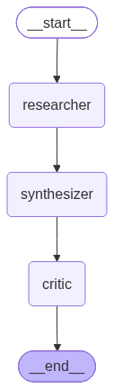

# 🕵️ Multi-Agent Research Assistant

An autonomous, multi-agent AI research system built with **LangGraph** and **Ollama**. This project features a Planner, Researcher, Synthesizer, and Critic agent that work together to research complex topics, self-correct, and produce cited reports—all running 100% locally on your machine (with optional cloud LLM support).

## 🏗️ Architecture

This project uses a **Two-Phase Agentic Workflow** to ensure human-in-the-loop control and prevent infinite revision loops.



- **Phase 1: Planning** - The Planner agent decomposes the user's query into 3-5 focused sub-questions. Execution pauses for human review/approval.
- **Phase 2: Research Loop** - 
  1. **Researcher**: Executes live web searches (via Tavily API) for each sub-question.
  2. **Synthesizer**: Compiles the findings into a cohesive, cited draft.
  3. **Critic**: Evaluates the draft against the raw findings. If claims are unsupported, it loops back to the Researcher (up to `MAX_REVISIONS` times).

## ✨ Key Features

- 🧠 **100% Local LLM Support**: Runs on `qwen2.5:7b` via Ollama (zero API costs, complete privacy). Easily swappable with OpenAI/Groq.
- 🛑 **Human-in-the-Loop (HITL)**: Manual approval step between planning and execution to guide the research direction.
- 🔄 **Self-Correction Loop**: The Critic agent validates citations and facts, triggering automated re-research if hallucinations are detected.
- 🛡️ **Bulletproof Parsing**: Custom regex-based JSON extraction ensures local models don't crash the pipeline with malformed outputs.

## 🚀 Getting Started

### 1. Prerequisites
- Python 3.10+
- [Ollama](https://ollama.com/) installed and running
- A free [Tavily API Key](https://app.tavily.com/) for web search

### 2. Installation
```bash
# Clone the repository
git clone https://github.com/YOUR_USERNAME/multi-agent-researcher.git
cd multi-agent-researcher

# Install uv (if not already installed) and create virtual environment
curl -LsSf https://astral.sh/uv/install.sh | sh
uv venv
source .venv/bin/activate  # On Windows: .venv\Scripts\activate

# Install dependencies
uv pip install -r requirements.txt

# Pull the local LLM
ollama pull qwen2.5:7b